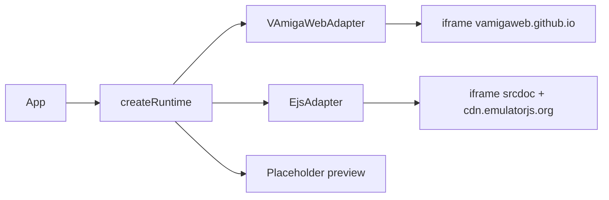

# Product Requirements Document (PRD) v0.12.0
## RGME — Milestone 12: Real Amiga Emulation — vAmiga & PUAE (EmulatorJS) as selectable adapters

- **Version:** 0.12.0 · **Status:** Approved / In Execution
- **Framework:** SkillWeave Discovery → Design → Blueprint → PromptChain (generate/validate/execute)
- **Methodology:** Assay · **Autonomy:** Unicorn · **Session schedule:** batch
- **Author:** `typelicious <typelicious@gmail.com>`
- **Inputs:** `.skillweave/discovery/discovery-report.md`, `.skillweave/design/m12-embedded-emulator-surface.md`

## 1. Executive Summary
M11 shipped an adapter that **draws fake per-title scenes** and labelled it "Full Amiga (PUAE)". M12 replaces that with two **real** emulator cores, both behind `RuntimeAdapter` (ADR-004), selectable in the UI:
1. `vamiga` — vAmigaWeb (vAmiga WASM core) driven over its documented `postMessage` protocol.
2. `puae` — PUAE libretro core via EmulatorJS 4.2.3 (`EJS_core="amiga"`).
The old renderer survives only as `preview`, honestly labelled **"Placeholder preview — not an emulator"**.

## 2. Problem Statement
Users mount real ADFs/ZIPs and see invented graphics. Trust is broken; real games cannot be played. Black screens on failure hid the root cause.

## 3. Personas
Player · Preservationist (BYOR Kickstart) · Maintainer (testable adapters). See discovery report.

## 4. Functional Requirements
- **FR-1** `RuntimeKind = "vamiga" | "puae" | "preview" | "wasm" | "m68k" | "mock"`. Default **`vamiga`**.
- **FR-2** `VAmigaWebAdapter` implements `RuntimeAdapter`: mounts iframe into host element, waits for `render_run_state`, posts `{cmd:"load", file_name, file[, kickstart_rom]}`, maps start/pause/reset/mute/input; surfaces load timeout/error.
- **FR-3** `EmulatorJsPuaeAdapter` (real) implements `RuntimeAdapter` via same-origin `srcdoc` iframe loading `loader.js` from `dataUrl` with `EJS_core="amiga"`, game as blob URL + `EJS_gameName="<name>.adf"`; maps start/pause/reset/mute/input.
- **FR-4** Both read disk bytes through the existing `mediaProvider`; ZIP/IPF are already unpacked upstream (M11-DISK-001). Multi-disk: first disk boots; `insertMedia` remounts with the new disk.
- **FR-5** Kickstart: user ROM (BYOR from `KickstartRomStore`) injected where the protocol allows (vAmiga: `kickstart_rom`; EJS: best-effort `EJS_biosUrl`); otherwise AROS.
- **FR-6** UI: Viewport exposes `data-testid="emulator-host"`; RuntimeSwitch lists `vAmiga (real emulator)`, `PUAE / EmulatorJS (real emulator)`, `Placeholder preview (not an emulator)`, plus WASM/68000/Mock; status chip + loading/error layer.
- **FR-7** No emulator binary is vendored; `baseUrl` / `dataUrl` are configurable for self-hosting.

## 5. Non-Functional
- Zero regressions on the existing test suite; `npm run build` green.
- Adapters are DOM-injectable (frame factory, message source, timers) → unit-testable without network.
- Load timeout 20 s → visible error, never a silent black screen.

## 6. Technical Architecture & Data Boundaries

| Boundary | Kind | Contract |
|---|---|---|
| RGME ⇄ vAmigaWeb iframe | adapter/process | `postMessage` v-protocol (artifact: message schema; versioning: pinned to vAmigaWeb `js/vAmiga_ui.js` as of 2026-11-05, feature-detected via `render_run_state`; producer/consumer: RGME adapter ⇄ vAmigaWeb; compat: unknown messages ignored) |
| RGME ⇄ EmulatorJS iframe | adapter/process | `EJS_*` globals + `parent.postMessage({rgme:"ejs",type})` (versioning: EmulatorJS 4.2.3 `/stable/`; compat: missing method → error status) |
| Adapter ⇄ media | storage | `mediaProvider(media) → Uint8Array` ADF bytes |

## 7. Success Metrics (binary)
1. `npm test` all packages pass incl. new adapter contract tests.
2. `npm run build` (core + web) passes.
3. Default runtime on fresh load is `vamiga`; `vamiga`, `puae`, `preview` all selectable.
4. With a fake frame host, `loadGame` → load message sent with ADF bytes and file name; `reset`/`pause`/`start`/input produce the documented messages.
5. Preview adapter's capabilities name contains "not an emulator".
6. Manual (documented, not CI): real browser shows real Amiga boot via both cores.

## 8. Scope
**In:** both adapters, factory/UI/default, honest labeling, tests, docs. **Out:** vendoring cores, savestates for embedded cores (capability false), CRT WebGL on iframe content, IPF flux accuracy.

## 9. Risks
| Risk | Mitigation |
|---|---|
| Upstream protocol drift | feature-detect + timeout error + pinned notes |
| Network/CSP blocks | visible error, configurable URLs |
| EJS BYOR ROM naming | AROS default; best-effort flagged |
| GPL | runtime load only; no copy in repo; NOTICE entry |
| Real-browser behaviour unverifiable in CI | explicit manual smoke checklist |

## 10. Tasks
`M12-HOST-001` · `M12-VAMIGA-001` · `M12-EJS-001` · `M12-UI-001` · `M12-DOC-001` (see `prd.json`).
