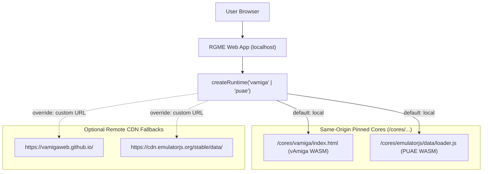

# Product Requirements Document (PRD) v0.13.0
## RGME — Milestone 13: Local Pinned Emulators & License Harmonization (GPL-3.0)

- **Version:** 0.13.0 · **Status:** Approved / In Execution
- **Framework:** SkillWeave Blueprint (Ralph Loop / Assay)
- **Methodology:** Assay · **Autonomy:** Unicorn · **Session schedule:** batch
- **Author:** `typelicious <typelicious@gmail.com>`
- **Inputs:** `.skillweave/design/m13-pinned-cores-architecture.md`

## 1. Executive Summary
Milestone 13 delivers local pinned execution for both **vAmiga** and **PUAE (EmulatorJS)** real Amiga emulator cores, eliminating external CDN dependencies, cross-origin browser alerts, and offline failure. To enable clean binary vendoring and distribution without legal tension, RGME is formally relicensed under the **GNU General Public License v3.0 (GPL-3.0-or-later)**, matching vAmiga (GPL-3.0) and PUAE (GPL-2.0+ / GPL-3.0).

Both emulators remain selectable in the UI as first-class adapters, booting by default from pinned local Same-Origin endpoints.

## 2. Problem Statement
Remote loading of emulator cores introduces:
1. Third-party modal alert popups (e.g. from `vamigaweb.github.io`) that intercept UI operations.
2. Complete failure when offline or when CDNs change or experience downtime.
3. Lack of strict version pinning across environments.
4. Perceived licensing ambiguity between MIT and GPL-3.0 when bundling WASM cores.

## 3. License Harmonization & Legal Assessment
- **Relicensing:** Transition RGME root from MIT to **GPL-3.0-or-later**.
- **Scope:** Covers RGME engine code, adapters, UI, and tooling.
- **Clarification:** Preserves the BYOR (Bring Your Own ROM) disclaimer for proprietary Commodore Kickstart ROMs and commercial disk images.
- **Synthetic Assets:** CC0 1.0 Universal dedication for demonstration media (`rgme-scene-intro.adf`).

## 4. Functional Requirements
- **FR-1 (License):** Root `LICENSE` and `package.json` updated to `GPL-3.0-or-later`. ADR-004 (`docs/emulators.md`) updated with pinning rationale.
- **FR-2 (Local Core Hosting):** `packages/web/public/cores/` established with dedicated subdirectories for `vamiga` and `emulatorjs`.
- **FR-3 (vAmiga Local Pinned Adapter):** `VAmigaWebAdapter` defaults to local `/cores/vamiga/index.html` (Same-Origin). Supports graceful fallback to remote `https://vamigaweb.github.io/` when explicitly configured.
- **FR-4 (PUAE Local Pinned Adapter):** `EmulatorJsCoreAdapter` defaults to local `/cores/emulatorjs/data/` (Same-Origin). Supports graceful fallback to remote `https://cdn.emulatorjs.org/stable/data/` when explicitly configured.
- **FR-5 (Runtime Switching):** Both adapters (`vamiga` and `puae`) are selectable via the UI header runtime dropdown.
- **FR-6 (Telemetry & Identification):** Runtime capabilities and telemetry HUD report whether the active core is operating in **Pinned (Local)** or **Remote (CDN)** mode.
- **FR-7 (Zero Regressions):** ADF and ZIP extraction pipeline (`resolveDiskBytesAndName`), BYOR Kickstart injection, and floppy sound effects remain 100% operational.

## 5. Non-Functional Requirements
- **Offline Readiness:** RGME web application boots and plays ADF/ZIP disks with zero internet connection required.
- **Test Integrity:** All automated unit and integration tests pass without network requests (`BypassSandbox: false`).
- **Build Quality:** `pnpm build` compiles core, cli, and web packages cleanly with zero type errors.

## 6. Architecture & Data Boundaries

## 7. Success Metrics (Binary Verification Gates)
1. `LICENSE` contains GNU General Public License v3.0 text with third-party asset clarifications.
2. `package.json` states `"license": "GPL-3.0-or-later"`.
3. `VAmigaWebAdapter` defaults to local pinned path `/cores/vamiga/index.html`.
4. `EmulatorJsCoreAdapter` defaults to local pinned path `/cores/emulatorjs/data/`.
5. `packages/web/public/cores/` contains runnable local runners and core assets.
6. `pnpm -r test` passes 100% (all existing tests + new M13 tests).
7. `pnpm -r build` produces a complete production bundle with `/cores/` copied to `dist/`.
