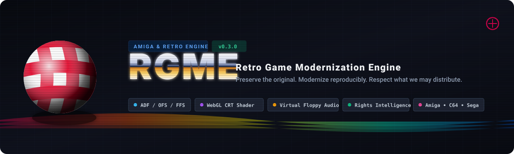

<p align="center">
  
</p>

<p align="center">
  <a href="https://github.com/typelicious/rgme/actions/workflows/ci.yml"></a>
  <a href="https://opensource.org/licenses/MIT"></a>
  <a href="https://www.typescriptlang.org/"></a>
  <a href="https://vitest.dev/"></a>
  <a href="https://vitejs.dev/"></a>
  <a href="#sponsor-this-project"></a>
</p>

<p align="center">
  <a href="#-quick-start"><b>🚀 Quick Start</b></a> •
  <a href="#-features"><b>🕹️ Features</b></a> •
  <a href="#-architecture"><b>🏛️ Architecture</b></a> •
  <a href="#-rights-intelligence"><b>⚖️ Rights Intelligence</b></a> •
  <a href="#-sponsor-this-project"><b>💖 Sponsor this Project</b></a>
</p>

---

## What is RGME?

**RGME (Retro Game Modernization Engine)** is a local-first, browser-first platform for playing, preserving, inspecting, and modernizing classic computer games without altering original historical bytes.

Traditional emulation workflows are fragmented: game ROMs sit in unverified folders, emulator configurations leak into game logic, modern controllers require manual binding, and copyright provenance is detached from executables.

RGME solves this through two **Golden Laws**:

1. **Original Content is Immutable:** Floppy disk images (ADF) and ROMs are never modified. Modern controls, display treatments, metadata, save states, and enhancements exist purely as external, declarative, versioned layers.
2. **Rights Policy Law:** *Unknown rights never become permission by inference.* If distribution or commercial permissions cannot be proven by primary evidence, RGME restricts execution to `local_only` (BYOG — Bring Your Own Game) and disables unauthorized export.

---

## 🕹️ Features

### 💾 Pure TypeScript Amiga Filesystem Engine
* **Zero Native C Dependencies:** Fast, in-memory parser for standard Amiga 880 KB Floppy Disks (`.adf`).
* **Full AmigaDOS Decoding:** Validates 32-bit Kickstart bootblock checksums, decodes Root Blocks (Sector 880), OFS/FFS directory trees, and extracts file contents directly in browser and CLI.

### 💽 Virtual Floppy Controller (`DF0:`–`DF3:`) & Mechanical Audio
* **Multi-Drive Subsystem:** Manage up to four virtual drives simultaneously with real-time cylinder tracking (0–79) and animated LED indicators.
* **Mechanical Sound Synth:** Web Audio API synthesizer reproducing the authentic mechanical Amiga floppy head step clicks (*"clack-clack"*), seek chirps, and drive spin noise.
* **Disk Swap Drawer:** Hot-swap disks on the fly for multi-disk titles (*Flight of the Amazon Queen*, *Beneath a Steel Sky*).

### 📺 High-Fidelity WebGL CRT Shader Pipeline
* **Authentic Display Profiles:** Toggle between clean integer pixel scaling and real-time WebGL CRT simulation.
* **Custom Shader Engine:** Scanlines with adjustable depth, aperture grille shadow mask, subtle barrel curvature, and phosphor persistence bloom.
* **Monitor Presets:** *Commodore 1084S*, *Sony Trinitron CRT*, *Retro Arcade*, and *Clean Pixel*.

### 💾 Persistent Save-State Engine
* **IndexedDB Storage:** Save slots 1–10 preserved locally in browser storage across sessions.
* **Visual Thumbnail Previews:** Every save state automatically captures a live canvas PNG preview alongside timestamp and disk SHA-256 metadata.
* **Portable State:** Export and import `.rgmesave` archives with cryptographic validation.

### 🎮 Hardware Gamepad Subsystem
* **HTML5 Gamepad API:** Auto-detects connected USB and Bluetooth controllers (Xbox, DualShock/DualSense, 8BitDo, generic retro pads).
* **Tactile HUD Visualizer:** Real-time feedback overlay showing live D-Pad and Fire button presses.
* **Custom Remapping:** In-app button remapping dialog with persistence.

### 📚 Persistent Browser Game Shelf
* **Local Collection Manager:** Drag-and-drop ADF disk images to instantly calculate client-side SHA-256 hashes, match rights, and persist games in your browser shelf.
* **Rights Filtering:** Filter your library by Rights Status (Class A / C Freeware vs. Class D Commercial), Platform, and Chipset.

---

## 🏛️ Architecture

RGME is structured as a TypeScript monorepo built with pnpm workspaces:

```text
├── packages/
│   ├── core/                  # @rgme/core
│   │   ├── src/adf/           # Pure TS Amiga Floppy Filesystem Parser
│   │   ├── src/drive/         # Virtual Floppy Controller & Mechanical Audio Synth
│   │   ├── src/profile.ts     # Zod schemas for GameProfile v0.2 & Multi-Platform
│   │   ├── src/rights.ts      # Rights Policy Engine & Decision Matrix
│   │   └── src/runtime.ts     # RuntimeAdapter universal abstraction
│   ├── cli/                   # @rgme/cli
│   │   ├── src/scan.ts        # Streaming directory scanner & hash resolver
│   │   └── src/bin.ts         # 'rgme scan <dir>' CLI tool
│   └── web/                   # @rgme/web
│       ├── src/components/    # Viewport, FloppyDrives, SaveDrawer, LibraryShelf
│       ├── src/lib/crt/       # WebGL CRT fragment shader pipeline
│       └── src/lib/gamepad/   # HTML5 Gamepad API connection manager
├── concept/                   # Rights matrices, audits, and Amiga library corpus
└── assets/                    # Project banners and visual design assets
```

### Decoupled Runtime Abstraction
The frontend and game profiles never import emulator binaries directly. Everything communicates across the generic `RuntimeAdapter` interface:

```typescript
interface RuntimeAdapter {
  identifyCapabilities(): RuntimeCapabilities;
  loadGame(profile: GameProfile): Promise<void>;
  start(): Promise<void>;
  pause(): Promise<void>;
  reset(): Promise<void>;
  saveState(slot: string): Promise<Uint8Array>;
  loadState(slot: string, state: Uint8Array): Promise<void>;
  setInputMapping(mapping: InputMapping): Promise<void>;
  setDisplayProfile(profile: DisplayProfile): Promise<void>;
  insertMedia(media: MediaReference): Promise<void>;
}
```

---

## ⚖️ Rights Intelligence

RGME introduces the retro preservation world's first formal **Rights Intelligence Subsystem**:

| Rights Class | Status | Policy Decision | Example Titles |
| :---: | :--- | :--- | :--- |
| **A** | Verified Public Domain / Open License | **Full Permissions** (Local execution, binary redistribution, browser hosting allowed) | `rgme-scene-intro.adf` |
| **C** | Explicit Freeware / Authorized Redistribution | **Redistribution Permitted** (Original binaries allowed; modifications require separate license) | *Flight of the Amazon Queen*, *Beneath a Steel Sky*, *Lure of the Temptress* |
| **D / E** | Commercial Active / Unresolved Chain of Title | **Local Execution Only (BYOG)** (Redistribution and browser hosting denied without title license) | *The Secret of Monkey Island*, *The Settlers*, *Speedball 2*, *Defender of the Crown* |

---

## 🚀 Quick Start

### Prerequisites
* Node.js >= 20.0.0
* pnpm >= 9.0.0

### Installation & Development

```bash
# Clone the repository
git clone https://github.com/typelicious/rgme.git
cd rgme

# Install workspace dependencies
pnpm install

# Run all test suites across packages (131 tests)
pnpm test

# Build all packages (@rgme/core, @rgme/cli, @rgme/web)
pnpm build

# Launch the interactive web player
pnpm --filter @rgme/web dev
```

Open [http://localhost:5173](http://localhost:5173) in your browser. Click **"Load Scene Demo"** to experience the Amiga copper rasterbars, graffiti shine logo, and the 4-channel Paula chiptune audio!

### CLI Library Scanner

Scan your local Amiga collection and match titles against the RGME Rights Matrix:

```bash
# Scan a folder of ADF files
pnpm --filter @rgme/cli rgme scan ./concept/fixtures
```

---

## 💖 Sponsor this Project

RGME is an independent, non-commercial open-source preservation initiative dedicated to keeping retro computing culture accessible, authentic, and legally clean.

Your sponsorship helps fund:
* **Evidence Research:** Tracking historical corporate mergers, copyright successions, and finding original author grants for orphaned Amiga titles.
* **Emulator Runtime Bridges:** Integrating WebAssembly cores for Amiga (PUAE), C64 (VICE), and Sega (Genesis-Plus-GX).
* **Open Source Development:** Writing pure TypeScript parsers for historic filesystem formats, tracker modules (MOD), and graphic standards (IFF/ILBM).

<p align="left">
  <a href="https://github.com/sponsors/typelicious">
    
  </a>
  &nbsp;
  <a href="https://ko-fi.com/typelicious">
    
  </a>
</p>

---

## 📄 License

This project is licensed under the **MIT License** — see the [LICENSE](LICENSE) file for details.

* **Software Engine:** MIT License © 2026 typelicious (André Lange).
* **Game Intellectual Property:** Original game titles, trademarks, disk images, and Kickstart firmware belong exclusively to their respective copyright holders.
* **Demonstration Assets:** The synthetic disk image `rgme-scene-intro.adf` is dedicated to the public domain under Creative Commons CC0 1.0 Universal.
